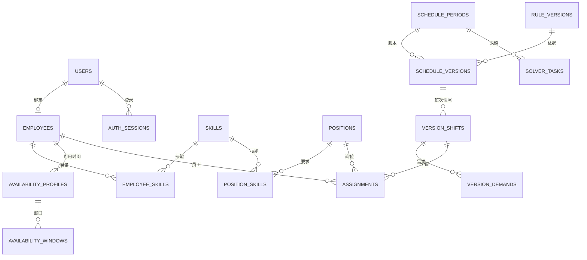

# 数据库结构设计（审查稿 V1）

日期：2026-11-09。目标 MySQL 8.0.45；当前数据库`intelligent_dynamic_scheduling`已通过Alembic 0001—0015建立，包含F01—F16所需业务表和模块表。

## 1. 通用约定

- InnoDB、utf8mb4。内部 ID 使用 BIGINT UNSIGNED，API 输出 ID 为字符串，避免 JavaScript 整数精度损失。
- 单门店，不引入多租户。审计时间 DATETIME(6) 以 UTC 保存；业务日期 DATE、时段 TIME 按 Asia/Shanghai 解释。API 时间点使用带时区的 ISO 8601。
- 可变实体带 created_at、updated_at、row_version（默认 1）。快照与业务历史只读，停用代替物理删除。
- 状态用 VARCHAR(32) + CHECK 白名单，数量和时长非负检查。外键默认 RESTRICT；关联表组合唯一。
- 所有密码、会话令牌和恢复秘密只存哈希；JSON 不存秘密。JSON 用于版本化规则与不可变快照，不替代可查询的主关系。
- 下面字段省略通用主键和时间字段；“?”表示可空；FK 表示外键；所有未标 ? 字段为必填。

## 2. 账号与人员

| 表 | 字段（类型与约束） | 用途 |
|---|---|---|
| users | username VARCHAR(32) UNIQUE（小写 ASCII）；display_name VARCHAR(64)；password_hash VARCHAR(255)；role VARCHAR(16)；status VARCHAR(32)；must_change_password BOOLEAN；temporary_password_expires_at DATETIME(6)?；reviewed_by FK users?；reviewed_at DATETIME(6)?；review_note VARCHAR(255)? | 状态 PENDING/ACTIVE/REJECTED/DISABLED；角色 MANAGER/EMPLOYEE；自注册固定员工 |
| auth_sessions | user_id FK users；token_hash BINARY(32) UNIQUE；scope VARCHAR(24)；expires_at DATETIME(6)；revoked_at DATETIME(6)? | 服务端会话；scope 为 BUSINESS/ACCOUNT_STATUS/PASSWORD_CHANGE |
| password_reset_requests | user_id FK users；status VARCHAR(16)；processed_by FK users?；processed_at DATETIME(6)?；note VARCHAR(255)? | 待处理/已处理/拒绝；不存临时密码或原始请求凭据 |
| employees | user_id FK users? UNIQUE；employee_no VARCHAR(32) UNIQUE；name VARCHAR(64)；status VARCHAR(16)；weekly_limit_minutes INT；employment_type VARCHAR(16) | 可提前建员工档案，审核时绑定；账号与员工均有效才参与排班 |
| skills | code VARCHAR(32) UNIQUE；name VARCHAR(64)；active BOOLEAN | 能力字典 |
| positions | code VARCHAR(32) UNIQUE；name VARCHAR(64)；active BOOLEAN | 岗位字典 |
| employee_skills | employee_id FK employees；skill_id FK skills；UNIQUE(employee_id,skill_id) | 员工具备技能 |
| position_skills | position_id FK positions；skill_id FK skills；UNIQUE(position_id,skill_id) | 多对多，要求员工同时具备该岗位列出的全部有效技能；空要求岗位视为通用岗位 |

每个员工至多绑定一个账号，一个账号至多绑定一个员工。管理员账号可以不绑定员工档案，管理身份不自动意味着参与排班。审核创建/绑定档案、修改账号状态在一个事务中完成。最后一个有效管理员不能由普通页面停用。

会话固定有效期建议 8 小时，无“记住登录”扩展；登录成功轮换令牌。账号停用、密码重置和修改立即撤销旧会话。待审核账号只有受限状态查询权限。

## 3. 时间与偏好

| 表 | 字段 | 用途 |
|---|---|---|
| availability_profiles | employee_id FK employees；effective_from DATE；effective_to DATE?；UNIQUE(employee_id,effective_from) | 常规可用时间版本，起止按周；同一员工有效区间不重叠 |
| availability_windows | profile_id FK availability_profiles；weekday TINYINT（1—7）；start_time TIME；end_time TIME | 一天可有多个窗口；start < end；相邻可合并，重叠拒绝 |
| availability_overrides | employee_id FK employees；work_date DATE；mode VARCHAR(16)；UNIQUE(employee_id,work_date) | REPLACE 替换当天常规可用时间；BLOCK 在常规窗口内扣除不可用区间 |
| override_windows | override_id FK availability_overrides；start_time TIME；end_time TIME | REPLACE 下为空表示全天不可用；BLOCK 要求至少一个区间 |
| preference_submissions | employee_id FK employees；period_id FK schedule_periods；status VARCHAR(16)；submitted_at DATETIME(6)?；UNIQUE(employee_id,period_id) | 区分未提交与已提交但无偏好 |
| preferences | submission_id FK preference_submissions；work_date DATE；shift_template_id FK shift_templates；kind VARCHAR(16)；weight INT；UNIQUE(submission_id,work_date,shift_template_id) | PREFER/AVOID；日期必须属于提交周期，权重 1—5 |
| ai_parse_records | employee_id FK employees；raw_text VARCHAR(2000)；status VARCHAR(24)；parsed_json JSON；base_snapshot JSON；model VARCHAR(64)；usage_json JSON；error_code VARCHAR(64)?；error_message VARCHAR(255)?；row_version INT；created_at DATETIME；confirmed_at DATETIME? | 保存F12待确认解析及确认前业务revision；不保存服务密钥；状态为PENDING_CONFIRMATION/CONFIRMED/REJECTED/FAILED |
| ai_explanation_records | requested_by FK users；employee_id FK employees?；period_id FK schedule_periods；candidate_id FK adjustment_candidates?；scope VARCHAR(32)；question VARCHAR(500)；facts_json JSON；output_json JSON；status VARCHAR(16)；model VARCHAR(64)；usage_json JSON；error_code/error_message?；created_at DATETIME | 保存F13请求人、已按角色过滤的事实、结构化解释和降级状态；不存服务密钥 |

没有常规配置时默认不可用；日期 REPLACE 可以提供独立可用时间；已批准请假始终最后扣除。同一天既有 REPLACE 又有 BLOCK 的需求通过提交最终区间解决，不允许两条冲突覆盖记录。

常规时间调整只对未来未发布周期生效。已发布周期的不可用变化走请假模块。版本快照记录求解时的实际可用区间，避免历史计算含义变化。

## 4. 班次、规则与班表

| 表 | 字段 | 用途 |
|---|---|---|
| shift_templates | code VARCHAR(32) UNIQUE；name VARCHAR(32)；start_time TIME；end_time TIME；active BOOLEAN | 固定班次，不跨午夜 |
| template_demands | template_id FK shift_templates；position_id FK positions；required_count INT；UNIQUE(template_id,position_id) | 模板默认岗位需求 |
| rule_versions | version_no INT UNIQUE；effective_week DATE；daily_shift_limit INT；weekly_minutes_limit INT；consecutive_days_limit INT；min_rest_minutes INT；weights_json JSON；schema_version INT；created_by FK users | 不可变；参数变更新增版本，effective_week 为周一 |
| schedule_periods | week_start DATE UNIQUE；current_version_id FK schedule_versions?；row_version BIGINT | 周期只持有当前发布版本指针；FK 在版本表建立后添加 |
| schedule_versions | period_id FK schedule_periods；version_no INT；parent_id FK schedule_versions?；status VARCHAR(16)；rule_version_id FK rule_versions；source_task_id FK solver_tasks?；base_published_id FK schedule_versions?；input_snapshot JSON；input_revision BIGINT；metrics_json JSON；created_by FK users；published_at DATETIME(6)?；published_by FK users?；UNIQUE(period_id,version_no) | DRAFT/PUBLISHED/SUPERSEDED/DISCARDED；发布后不改内容 |
| version_shifts | version_id FK schedule_versions；shift_key CHAR(36)；template_id FK shift_templates?；work_date DATE；name VARCHAR(32)；start_time TIME；end_time TIME；enabled BOOLEAN；UNIQUE(version_id,shift_key) | 每份班表各自拥有完整班次快照；shift_key 在版本复制时保留 |
| version_demands | version_shift_id FK version_shifts；position_id FK positions；position_name VARCHAR(64)；required_count INT；UNIQUE(version_shift_id,position_id) | 当前草稿可编辑，发布后不可变 |
| assignments | version_id FK schedule_versions；version_shift_id FK version_shifts；employee_id FK employees；position_id FK positions；employee_name VARCHAR(64)；position_name VARCHAR(64)；locked BOOLEAN；UNIQUE(version_id,version_shift_id,employee_id) | 同一员工在一个班次只占一个岗位 |

需求在具体版本中保存，不存在会被新需求覆盖的共享已发布班次。复制草稿同时复制班次、需求和安排，保留稳定 shift_key，行 ID 重新生成。跨版本差异按 shift_key、employee_id、position_id 比较，时间变化单独展示。

数据库为 version_shifts 建 UNIQUE(id,version_id)，assignments 使用对应组合 FK，避免安排关联到其他版本的班次。period.current_version_id 与 parent/base/source 引用的周期一致性由发布服务验证；循环外键通过迁移顺序处理。

每日班次数、重叠、跨周休息、连续工作日、岗位覆盖等跨行规则由统一校验器执行。发布后只能更新生命周期标签，禁止改动人员、需求、时间、快照和指标。前一版本被替代时仍保留历史内容。

## 5. 求解与共享基础设施

| 表 | 字段 | 用途 |
|---|---|---|
| solver_tasks | period_id FK schedule_periods；draft_version_id FK schedule_versions；base_version_id FK schedule_versions?；mode VARCHAR(16)；state VARCHAR(24)；input_snapshot JSON；input_revision BIGINT；draft_revision BIGINT；time_limit_seconds INT；worker_id VARCHAR(64)?；lease_until DATETIME(6)?；attempt INT；result_json JSON?；error_code VARCHAR(64)?；started_at/finished_at DATETIME(6)? | INITIAL 本方实现，REPAIR 同学实现；结果不自动发布 |
| scheduling_guard | id TINYINT PK（固定 1）；input_revision BIGINT | 单门店短事务串行化协调，见下一节 |
| idempotency_records | actor_id FK users；operation VARCHAR(64)；key_value VARCHAR(64)；request_hash BINARY(32)；response_json JSON?；expires_at DATETIME(6)；UNIQUE(actor_id,operation,key_value) | 发布、任务创建、审批等防重复 |
| audit_events | actor_id FK users?；action VARCHAR(64)；entity_type VARCHAR(32)；entity_id BIGINT?；trace_id VARCHAR(64)；summary JSON | 本方写必要事实；查询页面由同学实现；不记录密码和令牌 |
| outbox_events | event_key CHAR(36) UNIQUE；event_type VARCHAR(64)；aggregate_id BIGINT；payload JSON；state VARCHAR(16)；attempt INT；available_at DATETIME(6) | 发布事实与主业务同事务写入；通知消费由同学实现 |

求解状态 QUEUED/RUNNING/OPTIMAL/FEASIBLE/INFEASIBLE/UNKNOWN/FAILED。工作进程原子认领任务并设置租约；超时重试时旧进程不得覆盖新 attempt 的结果。项目初版单 worker，重试上限与扫描周期后续实现时配置。求解期间不持有数据库长事务锁。

## 6. 事务、版本与时间一致性

本项目只有单门店、约 20 人，优先采用可解释的统一短锁方案：所有改变排班有效输入的操作和正式发布，都先在事务中锁 scheduling_guard 的固定行，再按主键顺序锁受影响对象。只读请求无需持此锁。

修改技能、可用时间、规则、停用人员，以及未来请假批准等，均递增 input_revision。发布还递增周期 row_version；跨周输入变化可通过全局 revision 检出。草稿修改递增草稿 row_version。由服务端维护这些版本，客户端不能任意指定新版本值。

发布事务：鉴权 → 锁 guard → 校验幂等键 → 锁周期及草稿 → 比较客户端期望版本 → 按当前有效数据检查全量约束及相邻周 → 固化快照 → 替代旧发布版本 → 更新周期指针和 revision → 写审计及 outbox → 保存幂等响应 → 提交。

版本不符返回冲突，保留草稿；输入变化要求重新校验，不自动采用旧报告。所有路径都使用同一锁顺序，避免请假批准和发布检查之间插入不可用变化。正式发布短事务内只做确定性校验，不调用 AI 或运行长时间求解。

同学的请假审批需要在同一 guard 事务中保存状态及不可用事实；换班批准必须和发布原子提交。公共发布服务支持使用调用方事务，不内部擅自提交。

创建当前周新版本时，所有已开始班次及安排必须保持原样；比较完整班次内容，不能通过删除或换 key 绕过。历史复制为草稿时继承当前有效的已开始部分，只允许调整未来部分；存在冲突则拒绝发布。

## 7. 关键索引

- employees(status,employee_no)、users(status,created_at)。
- auth_sessions(user_id,revoked_at)、auth_sessions(expires_at)。
- availability_profiles(employee_id,effective_from)、availability_overrides(employee_id,work_date)。
- schedule_versions(period_id,status)、version_shifts(version_id,work_date)。
- assignments(employee_id,version_id)、assignments(version_shift_id,position_id)。
- solver_tasks(state,lease_until,created_at)、audit_events(entity_type,entity_id,created_at)、outbox_events(state,available_at)。

索引围绕真实查询建立；禁止提前宣称性能提升，编码后以执行计划与测试数据验证。

## 8. 模块数据与事务边界

| 逻辑对象 | 需保存的关联与边界 |
|---|---|
| leave_requests / adjustment_events | 员工、起止时间、状态、审批者和受影响班次；批准时提供有效不可用区间、生成缺岗事实并递增输入revision |
| swap_requests | 发起/接收员工、基准版本、稳定班次键、确认及审批状态；过期不可应用 |
| adjustment_candidates | 基准版本、输入revision、安排快照、指标、来源求解任务和方案状态 |
| notifications / publication_receipts | outbox事件、接收员工、已读及发布版本确认；按事件与接收人去重 |
| ai_parse_records / ai_explanation_records | F12保存员工原文、结构化结果和确认前revision；F13保存请求人、角色裁剪后事实和解释输出；两者均保存模型与token用量，不保存密钥 |
| store_settings | 门店展示设置、固定时区和默认求解时限；修改使用revision并写审计 |

F09—F16对应迁移为0009—0015。所有模块表由Alembic维护，历史迁移不原地改写；涉及发布或不可用时间的模块复用统一校验、发布事务和`approved_unavailability`适配。

## 9. 实体关系概览

## 10. 审查关注点

请审查注册审核、档案绑定、账号恢复、单门店范围、岗位需全部技能、发布历史不可改及每人每日默认一个班次这些业务含义。字段类型、索引、外键、事务与错误码由开发方负责，不要求用户逐项决定。
