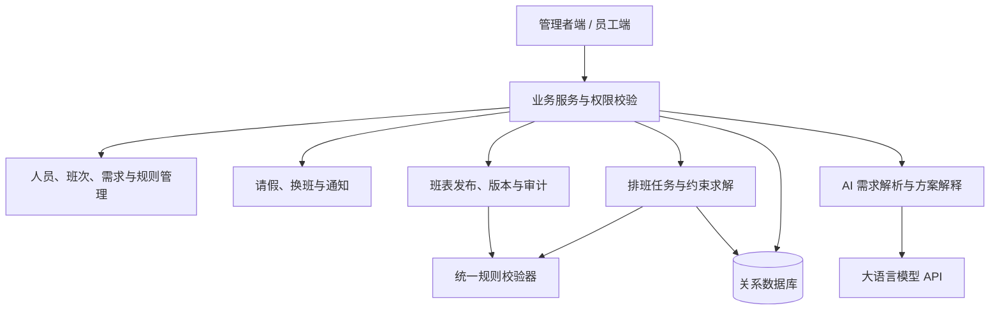

# 融合大语言模型与约束优化的智能排班及动态调班系统设计与实现

## 1. 文档定位与项目目标

- 文档版本：V1.0，2026-11-06。
- 适用课程：高级软件与数据库设计技术。
- 团队规模：2 人。
- 文档用途：作为需求讨论、界面设计、数据库建模、接口开发、联调测试和项目答辩的共同依据。
- 范围约定：本文为基于前期讨论形成的开发基线。单门店、固定班次、规则阈值等属于为控制课程项目范围而提出的设计约定，实际编码前由两位成员统一确认。

系统面向小型门店或服务团队，综合员工技能、可用时间、岗位需求和个人偏好生成班表，并在临时请假、换班等情况下提供调整方案。大语言模型承担自然语言需求解析与方案解释，约束优化模块承担排班计算，数据库承担业务状态、数据一致性与历史追溯。

核心价值体现在三个方面：减少手工排班中的冲突；在覆盖岗位需求的同时兼顾员工偏好与分配公平；以尽量少的人员变动处理临时缺勤。

### 1.1 预期交付成果

1. 可运行的 Web 系统，提供管理者端和员工端。
2. 完整业务闭环：提交需求 → 生成班表 → 检查与发布 → 请假或换班 → 调整与再次发布 → 通知与追溯。
3. 数据库结构、初始化脚本、可重复加载的演示数据。
4. 核心算法、AI 接入与业务接口代码。
5. 可复现的功能验收记录、演示脚本及课程报告。

## 2. 系统范围与设计约定

### 2.1 本期实现范围

以单个咖啡门店为演示场景，预置约 15 名员工，支持配置到 20 名员工。按自然周生成班表，使用门店时区 Asia/Shanghai，周一至周日为一个排班周期。

门店每天设置早班、中班、晚班，各班次有独立的起止时间和岗位人数。岗位示例为咖啡制作、收银、综合服务。员工可以具有多项技能，但在同一个班次只占用一个岗位名额。

| 设计项 | 本期约定 |
|---|---|
| 组织范围 | 单门店，管理者可以有多个账号 |
| 排班周期 | 按周生成，支持查看历史和下一周 |
| 时间范围 | 固定班次，班次开始与结束均在同一天；起止时间可配置 |
| 人员安排 | 本期默认每人每天最多一个班次，仍保留时间重叠检查 |
| 岗位覆盖 | 每个班次按岗位分别配置人数，发布时必须精确满足 |
| 员工时间 | 维护通常可工作时间，并支持指定日期例外；未配置可用时间的员工不参与自动排班 |
| 规则阈值 | 每周工时上限、连续工作天数等为项目演示参数，按配置执行 |
| 通知方式 | 系统内通知和未读提醒 |
| 导出方式 | 班表及统计导出 CSV |
| 数据来源 | 人工录入与预置模拟数据，不依赖真实企业系统 |

本期不包含工资核算、打卡考勤、真实短信、真实即时客流接入和多门店共享人员。仅在第 12 节设置一个正式拓展功能。

### 2.2 功能优先级

“基础闭环”与“增强体验”均属于本期计划功能，优先级仅表示实施顺序。第 12 节是唯一不计入本期验收的展望功能。

- **基础闭环**：身份权限、人员技能、班次需求、时间约束、规则配置、排班求解、冲突校验、发布、请假与动态调班、版本与日志。
- **增强体验**：换班协作、AI 解析与解释、方案比较、员工确认、通知中心、统计与 CSV 导出。

## 3. 用户角色与权限设计

| 能力 | 管理者 | 员工 |
|---|---|---|
| 人员、账号、岗位与技能管理 | 维护门店全部数据 | 查看本人资料 |
| 班次和用工需求配置 | 新增、修改、停用 | 查看已发布安排 |
| 排班规则配置 | 维护 | 查看与本人相关的规则说明 |
| 可用时间与偏好 | 查看，必要时代录并留痕 | 维护本人数据 |
| 生成、调整、发布班表 | 操作 | 无权限 |
| 请假、换班 | 审批 | 发起本人申请，回应涉及本人的换班 |
| 统计与历史版本 | 查看全店 | 查看本人排班与工时 |
| 通知 | 接收审批、冲突等通知 | 接收本人排班及申请通知 |
| 操作日志 | 查询 | 不查看全店日志 |

账号流程更新：支持账号密码登录、员工自注册和管理员协助找回密码。自注册仅可申请员工身份，管理员审核后启用；找回密码由管理员核实身份后重置，首次登录强制修改。详见 ui-design.md。停用账号或员工后禁止新排班分配，并提示尚未结束的安排需要处理；历史记录保留。权限必须在服务端校验，员工不能通过修改请求参数读取他人请假原因等信息。

## 4. 系统总体设计

### 4.1 模块结构

建议采用前后端分离与单体业务后端，以模块划分职责。关系数据库作为业务事实来源；排班任务异步执行并保存状态，前端通过轮询查询进度。AI 服务通过统一适配层调用，便于更换模型及处理失败。

2026-11-07 技术基线更新：采用 Vue 3 + TypeScript、FastAPI、MySQL 8.0 和 OR-Tools，Python 使用项目独立的 Conda schedule 环境。后端按模块组织，排班计算在独立执行进程中运行；版本与实测结果见 technical-baseline.md。前端依赖与数据库认证尚未核验。

### 4.2 三类计算的职责

| 组件 | 输入 | 输出 | 责任边界 |
|---|---|---|---|
| AI 解析模块 | 自然语言、当前日期、班次配置 | 待确认的可用时间、偏好等字段 | 不直接修改规则或班表 |
| 约束优化模块 | 结构化人员、需求、规则、基准班表 | 可行方案、目标指标、求解状态 | 不违反硬约束；不保证每次均证明最优 |
| 统一规则校验器 | 候选安排及当前有效数据 | 具体违规项 | 自动排班、手动调整和发布共同使用 |
| AI 解释模块 | 已计算的方案、变更列表、指标 | 面向用户的方案说明 | 不能凭空增加计算结果或改变推荐排序 |

AI 失败时，可使用表单录入和固定模板解释继续操作；求解失败时，保留当前已发布班表，提供手动编辑与校验入口。

## 5. 核心业务流程与状态设计

### 5.1 首次排班流程

1. 管理者维护员工、技能、班次、各岗位人数和排班规则。
2. 员工提交下一周可用时间及偏好，系统提示尚未完成填报的人员。
3. 管理者发起排班，系统固定本次输入快照，创建异步求解任务。
4. 求解成功后形成草稿，展示班表、偏好满足情况和工时分配。
5. 管理者可手动调整；系统即时展示冲突，允许保存带冲突草稿，但禁止发布。
6. 发布前依据最新人员、请假、规则及当前版本再次校验；通过后原子性地发布新版本。
7. 员工收到通知，可以查看个人班次并确认已阅。

### 5.2 请假与动态调班流程

1. 员工选择日期、时间区间并提交请假原因。
2. 系统提示申请覆盖的已发布班次。待审批申请尚不改变可用时间。
3. 管理者批准后，请假立即成为不可用时间，相关班次标记为“缺岗待处理”，创建调班事件。
4. 当前班表保留历史分配记录，但请假员工不再计入对应岗位的有效覆盖；界面同时显示请假标识与岗位缺口。
5. 管理者生成调班方案。求解器以当前发布版本为基准，优先直接替补，必要时允许联动调整其他未来班次。
6. 管理者比较方案、校验后发布新版本，系统通知受影响员工；调班事件记录所采用的方案和版本。
7. 找不到可行方案时，请假仍保持批准，缺岗继续显示；管理者补充人员或调整需求后重试。

不能通过拒绝记录已批准请假来伪装班表完整。已发布版本是历史事实，当前执行状态可以因请假变为“存在缺岗”；系统不得把这种状态展示为已经修复。

### 5.3 换班流程

本期支持两类申请：将自己的班次交给另一名员工，以及与另一名员工交换两个未来班次。

发起人选定目标员工与班次 → 系统初检资格和时间 → 对方同意或拒绝 → 管理者审批 → 再次校验当前版本与规则 → 发布新版本并通知双方。

对方未同意时不能进入管理者批准环节。审批时如原班表已变化，申请转为“已失效”，要求重新发起，不在旧版本上强行执行。

### 5.4 状态约定

| 对象 | 状态及主要流转 |
|---|---|
| 排班任务 | 排队中 → 运行中 → 最优解 / 可行解 / 已证明无解 / 限时未找到解 / 执行失败 |
| 班表版本 | 草稿 → 已发布 → 已被替代；草稿可废弃，已发布内容不可原地覆盖 |
| 周期执行状态 | 正常 / 存在缺岗；由最新已发布版本和已批准请假等当前事实计算 |
| 请假申请 | 待审批 → 已批准 / 已拒绝；待审批时可撤回 |
| 换班申请 | 待对方确认 → 待审批 → 已批准 / 已拒绝；并支持撤回、对方拒绝、已失效 |
| 调班事件 | 待处理 → 已解决；生成失败仍为待处理 |
| 班表阅读确认 | 待确认 → 已确认；按员工与发布版本单独记录 |

已批准请假如需取消，由管理者记录撤销原因并保留审计记录；撤销请假不会自动恢复旧安排，应重新检查班表。员工“确认已阅”是阅读回执，不是发布的前置条件；员工有异议时通过换班等正式申请处理。

## 6. 功能详细设计

### F01 账号与个人中心

**使用角色：**管理者、员工。

- 中文登录、员工注册、注册审核、找回密码、退出和修改密码，展示角色及账号状态。
- 管理者创建员工账号、重置初始密码、停用账号。
- 员工查看本人岗位技能、个人班次及申请记录。
- 密码仅存储安全哈希，不在页面或日志中回显。

**验收：**员工只能访问本人受限数据；停用账号不能登录；退出后原会话按所选认证机制失效。

### F02 员工、岗位与技能管理

**使用角色：**管理者。

- 维护姓名、编号、在岗状态、每周工时上限等基本资料。
- 配置岗位与相应技能，维护员工可承担的岗位。
- 支持姓名搜索、岗位筛选和在岗状态筛选。
- 停用技能或员工前展示受影响的未来安排，产生待处理提示。
- 已被历史班表引用的数据采用停用方式保留。

**验收：**一个员工可具备多种技能；同一班次分配到一个岗位后，不能同时算作另一个岗位的人数。

### F03 班次模板与岗位需求管理

**使用角色：**管理者。

- 配置班次名称、开始时间、结束时间及默认岗位人数。
- 将模板实例化为指定周每天的班次，支持按日期覆盖人数，例如周末增加收银岗位。
- 支持复制上一周需求，关闭指定日期或班次。
- 显示每周总岗位数与需求工时。
- 已发布班次变更以新版本处理；不能直接修改模板来改写历史。

**验收：**人数为非负整数，结束时间晚于开始时间；修改模板只影响后续新建班次。

### F04 可用时间与个人偏好

**使用角色：**员工填报，管理者查看。

- 设置每周通常可工作时间，按日期添加例外和不可用时间。
- 设置希望上或尽量避开的班次；“不能上班”和“不希望上班”在界面上明确区分。
- 以日历或时间表展示提交结果，支持修改未发布周期的要求。
- 管理者查看填报完整度，对尚未填报员工发送站内提醒。
- 已发布周期发生可用性变化时，提示走请假流程；修改后续常规时间不静默覆盖当前班表。

**时间判定：**班次必须完整落入员工有效可用时间，且不能与已批准请假相交。指定日期例外优先于常规时间，不可用区间优先于可用区间。

**验收：**“周三下午不方便”不能默认为普通偏好；AI 或表单需要用户明确选择是否不可排。

### F05 排班规则配置

**使用角色：**管理者。

- 配置每人每天最多班次数、每周工时上限、连续工作天数上限、班间最短休息时间。
- 配置偏好满足、工时均衡、晚班均衡的权重。
- 规则形成版本，记录生效周期、修改人和修改时间。
- 配置项提供解释和单位，校验数值范围。
- 时间重叠、人员有效性、岗位技能和已批准请假等基础约束不能被关闭。

**验收：**新规则不能改变历史版本记录；本期规则使用受控配置项，不提供任意自然语言生成可执行规则代码的能力。

### F06 自动生成周班表

**使用角色：**管理者。

- 选择周期并检查人员、需求、时间信息是否齐全。
- 发起排班后显示任务状态，防止重复点击产生重复任务。
- 求解结果落入草稿，显示求解耗时、求解状态和主要指标。
- 同一组输入可重新计算；每次任务保留独立记录与输入快照。
- 无解、超时和服务异常使用不同提示，不把“暂时没找到方案”宣称为“绝对无解”。

**验收：**正常样例可以生成无硬约束冲突的班表；缺少必要技能的样例显示具体缺口；任务失败不会覆盖当前班表。

### F07 班表工作台与手动编辑

**使用角色：**管理者。

- 提供“日期 × 班次”的周视图，卡片显示岗位和员工。
- 按员工、岗位筛选，点击查看班次详情、人员技能及可用情况。
- 使用点击选择方式新增、替换、移除安排；拖拽不作为本期必需交互。
- 修改后即时校验，违规项精确定位到员工、日期和规则。
- 可锁定草稿中的指定安排，重新生成时保留；锁定导致无解时提示解除或调整。
- 显示待补岗位、偏好未满足项及草稿保存状态。

**验收：**可以保存待完善草稿；带硬冲突或岗位缺口的草稿不能发布。

### F08 发布、版本管理与差异比较

**使用角色：**管理者发布，员工查看本人版本。

- 发布前重新读取有效数据并完成全量校验。
- 发布成功后生成版本号、发布人、时间、规则及需求快照。
- 查看版本列表和新旧差异，包括新增、移除、替换人员及岗位变化。
- 历史版本只读；需要恢复时，从历史版本复制为新草稿，再按当前事实校验和发布。
- 当前周只允许一个生效发布版本；旧版本标记为已被替代。
- 禁止修改已经开始或结束的班次；当前周调班只作用于尚未开始的班次。

**验收：**两位管理者基于同一版本发布时，只有第一份成功，另一份收到版本冲突提示并刷新；历史版本仍可准确还原。

### F09 请假申请与审批

**使用角色：**员工申请，管理者审批。

- 输入开始结束时间、原因，并展示涉及的未来班次。
- 待审批申请可撤回，管理者批准或拒绝时填写处理意见。
- 批准后创建有效不可用记录，识别受影响岗位并生成调班事件。
- 防止同一时间重复提交重叠的待审批或已批准申请。
- 员工查看审批状态，管理者按状态和日期筛选。

**验收：**批准请假后，即使尚无替班人也必须展示真实缺岗；同一审批请求重试不重复产生事件。

### F10 换班申请与审批

**使用角色：**员工、接收方、管理者。

- 发起班次转交或双向交换，选择目标员工及可选目标班次。
- 初检接收方技能、时间、工时和休息规则，展示不能选择的原因。
- 接收方同意或拒绝；同意后由管理者处理。
- 审批通过时，以最新版本重新校验整个变更，原子性更新相关安排并发布新版本。
- 任何参与班次已经开始、被其他变更替代或人员资格发生变化时，阻止批准并标记失效。

**验收：**双向换班不会出现只成功修改一方的情况；失败时保持原发布版本。

### F11 动态调班与方案比较

**使用角色：**管理者。

- 从缺岗事件或选定未来班次进入调班工作台。
- 展示缺口岗位、原人员、受影响时间和当前班表版本。
- 生成最多 3 个不同方案；实际只有一个可行方案时只显示一个。
- 以变更人数、变更班次数、偏好满足情况、工时和晚班分布比较方案。
- 默认优先满足硬约束，再减少已发布安排的变动，最后优化偏好与公平。
- 可以锁定不允许改变的安排，限制调班范围。
- 应用前重新校验方案是否过期；批准后发布新版本并关闭已解决的缺岗事件。

**验收：**具备直接替补条件时优先给出小范围调整；没有可行替补时不生成违反技能或时间要求的方案。

### F12 AI 自然语言需求解析

**使用角色：**员工。

- 支持输入“下周三下午不能上班，周末尽量安排早班”等表达。
- 将内容映射为日期、时间区间、不可用约束和班次偏好等限定字段。
- 提供“原文—解析结果”对照卡片，用户修改并确认后才保存。
- 相对日期按提交时门店日期解析，确认界面展示具体年月日。
- 对“下午”“晚一点”等含糊表达，使用已配置班次辅助选择，要求补充确认。
- 无法解析、结构校验失败或调用超时时，保留输入并切换表单。

**验收：**模型不能自行选择其他员工身份；确认后的字段仍经过服务端业务校验；重复提交同一确认操作不产生重复记录。

**实现状态（2026-11-09）：**已接入DeepSeek服务端适配层和`ai_parse_records`。模型输出必须先通过严格JSON结构校验，再进入待确认页；员工可修改日期例外、时段、班次偏好类型与权重，确认时才通过统一业务事务写入F04。日期限制为当天至未来90天，重复项、时段重叠和确认前数据变化会被拒绝。默认限额为员工每日30次、全局每日300次、输入2000字符、输出800 tokens、超时20秒；失败回退手工表单，不产生虚假结果。

### F13 AI 方案解释

**使用角色：**管理者，员工可查看与本人相关的说明。

- 根据实际候选方案及计算指标解释推荐理由、变化范围和取舍。
- 支持“为什么安排我上晚班”“为什么推荐这个替班人”等限定问题。
- 解释附带相关可验证指标，例如本周晚班次数、该岗位技能是否满足。
- 输入模型的内容按角色过滤；不给员工展示他人的请假原因。
- 模型调用失败或解释校验不通过时，用固定模板展示事实。

**验收：**不能把候选可行解写成已证明最优；不能声称所有偏好均满足而实际仍有未满足项；不能通过对话直接发布班表。

**实现状态（2026-11-09）：**已接入`ai_explanation_records`和角色化解释接口。管理者可解释当前发布班表或调班候选；员工只能解释本人当前发布安排，模型输入在调用前完成过滤。输出严格限定为标题、结论、理由、证据和限制，候选事实固定包含`optimality_proven=false`。模型不可用或结构不合规时返回固定事实模板，状态标记`FALLBACK`；解释不能应用候选、发布班表或替代统一校验。

### F14 站内通知与员工确认

**使用角色：**管理者、员工。

- 发布班表、班次变化、申请审批、换班邀请、需求填报提醒均生成站内通知。
- 通知列表支持未读标识、全部已读及跳转到对应业务页面。
- 员工按发布版本确认已阅；管理者查看受影响员工的确认进度。
- 新版本仅要求受影响员工重新确认；未变更员工沿用原确认时，记录所依据的版本关联。
- 通知失败可以重试，不撤销已成功的业务操作，也不重复生成同一通知。

**验收：**员工收到的是已提交成功的班表变化；确认旧版本不会错误确认更新后的安排。

### F15 统计与导出

**使用角色：**管理者查看全店，员工查看本人。

- 按周统计计划工时、班次数、晚班次数、岗位缺口、偏好满足情况、调班次数和确认比例。
- 支持按员工、岗位和周期筛选。
- 工时是排班计划工时，不标记为实际出勤或薪资依据。
- 导出当前已发布班表、个人安排和统计数据为 CSV，包含周期与版本号。
- 导出文本需处理电子表格公式注入字符，保证中文可以正常打开。

**验收：**统计与当前生效安排一致；已请假且尚未被替补的安排不计入员工有效计划工时，岗位缺口仍可见。

### F16 操作记录与基础设置

**使用角色：**管理者。

- 查询规则修改、班表发布、请假审批、换班处理、账号停用等关键操作。
- 日志包含操作者、对象、时间、结果、关联版本及必要的变更摘要。
- 设置门店名称、营业日期、时区和演示参数；本期运行时区固定为 Asia/Shanghai。
- AI 调用记录保存状态、耗时及业务关联，密钥仅由服务端配置，不写入前端、业务日志或导出文件。

**验收：**能从某次班表变化追溯到操作人、申请单或调班任务及前后版本。

## 7. 排班规则与算法设计

### 7.1 硬约束

1. 员工处于可排班状态，具备被分配岗位所需技能。
2. 班次完整落入有效可用时间，不与已批准请假相交。
3. 同一员工的两个安排不能时间重叠；每人每日班次数不超过配置上限。
4. 每个班次各岗位人数精确满足配置；零需求岗位不能额外分配。
5. 一个员工在一个班次最多承担一个岗位，不能重复计算技能覆盖。
6. 员工每周计划工时不超过上限；工时采用整数分钟计算，避免浮点累计误差。
7. 连续工作天数、相邻班次休息时间满足配置。
8. 被锁定且仍然有效的安排必须保留；无效锁定需要用户处理。
9. 已开始的班次不参与动态调整。

连续工作天数和休息时间不能在周一重置。求解新一周时，需要读取前一周末足够长度的实际排班上下文；如果下一周已有发布安排，也需检查与其边界是否冲突。

### 7.2 软约束与评价指标

| 目标 | 计算口径 |
|---|---|
| 满足班次偏好 | 希望安排的班次得到满足、希望避开的班次未被安排时计为满足；统计分母为本周期有效偏好条目数 |
| 工时均衡 | 在可比员工组内比较计划工时或工时利用率；兼职与全职可按各自工时上限归一化 |
| 晚班均衡 | 在具备相关资格且可上晚班的员工组内比较晚班次数，不强求所有员工完全相等 |
| 少改动已发布班表 | 以员工、日期、班次、岗位构成安排键，统计基准方案和新方案之间的增删差异 |

没有有效偏好时显示“未提交偏好”，不显示 100% 满足。界面同时展示原始工时和班次数，让用户理解公平性指标的依据。

### 7.3 求解策略

设二元变量 `x[e,s,p]` 表示员工 e 是否在班次 s 承担岗位 p。仅对具备资格的组合创建变量，加入人员、时间、岗位覆盖等硬约束。

初次排班在可行域内优化偏好和公平性。动态调班采用分层目标：先满足全部硬约束；再尽量减少有效既有安排的变动；在相同或可接受变更范围内改善偏好和公平性。

由已批准请假强制导致的原安排移除，应单独列为“必需变更”，避免与可选择的额外扰动混在一起评价。多方案通过不同优化侧重点或排除已生成方案获得，不能把同一结果重复展示成多个方案。

设置可配置求解时间上限。限时内找到可行解但未证明最优时，标记“可行方案”；仅在求解器明确证明无解时标记“无可行方案”。保留计算状态和指标，支持后续报告评价。

### 7.4 冲突与无解说明

先做确定性的输入检查：岗位缺少合格人员、某时段无人可用、总需求超过明显可用容量、锁定安排违反请假等，发现后直接定位问题。

组合约束造成的无解可能没有单一原因。本期可以输出已确定的冲突和需要检查的约束组；若未实现正式的冲突集合分析，不宣称找到了全部或最小冲突原因。调整建议必须由管理者确认，系统不得自动放宽硬约束。

## 8. 页面与交互组织

### 8.1 管理者端

| 页面 | 主要内容 | 关键操作 |
|---|---|---|
| 工作概览 | 本周覆盖情况、待审批、未处理缺岗、未确认人员 | 进入处理页面 |
| 排班工作台 | 周班表、指标、任务状态、冲突列表 | 生成、编辑、锁定、检查、发布、导出 |
| 动态调班 | 缺岗事件、候选方案、变更对比 | 比较、调整范围、采用方案 |
| 人员与技能 | 员工列表、岗位技能关系 | 新建、编辑、停用 |
| 班次与需求 | 班次模板、每日期望人数 | 配置、复制、关闭班次 |
| 时间填报 | 员工可用时间、偏好、填报进度 | 查看、提醒、代录 |
| 规则配置 | 硬约束参数、软约束权重、规则版本 | 修改、生效周期设置 |
| 申请审批 | 请假与换班列表、影响范围 | 批准、拒绝、追踪 |
| 历史与统计 | 版本差异、指标趋势、操作记录 | 对比、复制为草稿、导出 |
| 通知与设置 | 未读消息、门店信息、个人账号 | 已读、设置、修改密码 |

### 8.2 员工端

| 页面 | 主要内容与操作 |
|---|---|
| 我的班表 | 本周安排、变更标记、个人工时、确认已阅 |
| 时间与偏好 | 手工填报、自然语言输入、解析结果确认 |
| 我的申请 | 发起请假或换班、撤回待处理申请、查看审批 |
| 换班邀请 | 查看转交或交换详情、同意或拒绝 |
| 通知与个人中心 | 消息、本人技能资料、密码修改 |

所有用户可见页面使用简体中文，采用已确认的极简浅色与蓝色主色方案，具体规范见 ui-design.md。管理者端优先适配桌面；员工端保证手机浏览器能够查看安排、提交申请和确认解析结果。具体页面可采用标签页合并，减少重复开发。

## 9. 数据设计与一致性要求

### 9.1 核心实体

以下是逻辑实体设计，实际建表时可在不损失历史与约束的前提下适度合并。

| 实体 | 主要字段或关系 |
|---|---|
| 用户、员工 | 账号、角色、状态；员工编号、工时上限、账号关联 |
| 岗位、技能、员工技能 | 岗位所需技能与员工已具备技能的多对多关系 |
| 班次模板、班次实例 | 时间、日期、模板来源、实际开始结束时间 |
| 岗位需求 | 班次实例、岗位、人数；发布时保存对应版本快照 |
| 常规可用时间、日期例外 | 员工、星期或日期、时间段、可用类型 |
| 偏好 | 员工、周期、班次或日期、偏好类型、权重 |
| 规则版本 | 参数、版本号、生效周期、修改人 |
| 排班周期 | 周起止日期、当前生效版本、并发控制版本号 |
| 班表版本 | 周期、父版本、状态、来源任务、发布信息、输入快照 |
| 人员安排 | 班表版本、员工、班次、岗位、锁定状态 |
| 排班任务、候选方案 | 输入快照、基准版本、求解状态、指标、耗时、方案结果 |
| 请假申请 | 员工、时间范围、原因、状态、审批信息 |
| 换班申请 | 发起人、接收人、相关安排、基准版本、双方及审批状态 |
| 调班事件 | 来源申请、缺口、处理状态、解决版本 |
| 发布确认 | 员工、版本、待确认或已确认状态、确认时间 |
| 通知、审计日志 | 接收人或操作者、业务关联、状态或操作摘要 |
| AI 调用记录 | 业务类型、关联对象、状态、耗时、结构化结果及确认状态 |

### 9.2 主要关系

- 员工与技能为多对多；岗位与技能可以是一对一或多对多，但必须固定一种校验语义。
- 排班周期与班表版本为一对多，周期指向唯一当前发布版本。
- 班表版本与人员安排为一对多，安排连接员工、班次及岗位。
- 一个请假申请可以影响多个班次，一个调班方案可以同时修复多个缺口。
- 调班事件应能关联受影响安排及解决版本，避免只凭文本判断是否解决。
- 一份候选方案依赖一个基准版本和输入快照，应用时检查依赖是否仍有效。

### 9.3 必须实现的数据约束

1. 员工编号、账号唯一；员工技能关系不重复；一个版本内同一员工不得重复占用同一班次。
2. 日期、起止时间、需求人数、状态值等使用数据库约束和服务端校验共同保护。
3. 所有业务外键保持引用完整性，历史已引用记录不直接物理删除。
4. 发布采用事务：校验基准版本 → 校验当前有效规则 → 创建或固化发布版本 → 更新周期指针 → 写入审计及待通知记录。
5. 请假批准和发布使用相容的锁定顺序或并发控制机制，避免“发布检查后、提交前新批准请假”造成遗漏。
6. 双向换班在一个事务中完成；失败整体回滚。
7. 发布、审批、应用调班方案等操作带幂等标识，网络重试不重复执行。
8. 已发布版本保存员工显示信息、班次时间、岗位需求、规则和指标等必要快照，后续改名或修改模板不能改变历史含义。
9. 求解任务运行期间输入发生变化时，可以保留候选结果，但标记为需要重新校验，不能直接应用。
10. 通知采用已提交业务记录驱动；发送与重试不阻塞核心事务。

### 9.4 查询与索引考虑

主要查询路径为按周期查班表、按员工与日期查安排、按状态查申请、按接收人查未读通知、按业务对象查审计日志。围绕这些路径建立组合索引，并通过执行计划说明其作用。

课程报告可重点展示规范化的人员技能关系、班表版本与历史快照的取舍、事务与并发冲突处理，以及索引前后的查询差异。演示性能数据应来自实际测量。

## 10. 接口边界与异常处理

### 10.1 关键接口分组

| 分组   | 典型业务操作          | 关键输入与输出            |
| ---- | --------------- | ------------------ |
| 身份权限 | 登录、退出、修改密码      | 登录凭据；用户及角色         |
| 基础资料 | 员工、技能、班次、需求维护   | 结构化配置；校验结果         |
| 时间偏好 | 查询、提交、AI 解析、确认  | 员工与周期；待确认解析记录      |
| 排班任务 | 创建任务、查询状态与结果    | 周期、规则版本；任务 ID、求解状态 |
| 班表   | 草稿编辑、校验、发布、版本比较 | 基准版本、变更内容；冲突项或新版本  |
| 请假换班 | 发起、撤回、回应、审批     | 申请内容、当前状态；处理结果     |
| 动态调班 | 生成候选、比较、采用      | 事件、锁定范围、基准版本；候选与指标 |
| 通知统计 | 查询、已读、确认、导出     | 用户或周期；权限范围内数据      |

具体 URL 与字段的首版设计见 contracts/api-contract.md，数据库结构见 database-design.md；完整设计不等于已实现；当前账号与员工目录实现范围详见 framework-status.md。所有写操作返回明确的业务结果；核心操作接收当前版本号，必要时接收幂等键。

### 10.2 通用异常约定

| 场景 | 用户看到的结果 | 系统行为 |
|---|---|---|
| 数据缺失 | 指明缺失人员、时间或需求 | 不启动无意义求解 |
| 输入不合法 | 定位字段并说明原因 | 拒绝保存非法数据 |
| 权限不足 | 无权操作该对象 | 服务端拒绝并记录必要日志 |
| 已证明无解 | 无可行方案及已确定问题 | 保留原班表，允许修改条件 |
| 超时未找到解 | 在时间限制内未找到方案 | 不宣称无解，可重试或手工处理 |
| 版本冲突 | 班表已更新，请刷新后重新检查 | 不覆盖新版本 |
| AI 异常 | 解析暂不可用或显示固定说明 | 保留用户输入，提供表单 |
| 通知暂时失败 | 核心操作成功，通知待发送 | 后台重试且去重 |

## 11. 开发组织、测试与项目展示

### 11.1 建议开发顺序

| 阶段 | 目标 | 阶段完成标志 |
|---|---|---|
| 第一阶段 | 明确规则、数据模型和页面原型 | 两人对状态流转及硬约束有一致定义 |
| 第二阶段 | 账号、人员、技能、需求、时间填报 | 能录入一套完整排班输入 |
| 第三阶段 | 求解、草稿、校验、发布与版本 | 能生成并发布一周有效班表 |
| 第四阶段 | 请假、动态调班、换班、并发控制 | 能处理一次完整的缺勤和换班流程 |
| 第五阶段 | AI、通知确认、统计导出 | 形成完整交互体验 |
| 第六阶段 | 异常测试、数据准备、报告演示 | 演示可重复，关键测试通过 |

### 11.2 两人分工（2026-11-07 更新）

用户与 AI 助手负责基础框架及 F01—F08 的完整设计、开发、测试和交接。同学负责 F09—F16 的具体实现，本方仅预留文字接口说明和必要的共享能力。

框架可运行且接口约定明确后即可并行开发，无需等待 F01—F08 全部完成。最新合作边界见 [合作方式](collaboration.md)，实施顺序见 [开发计划](development-plan.md)。仓库相关工作由用户自行负责。
### 11.3 必测场景

| 编号 | 场景 | 预期结果 |
|---|---|---|
| T01 | 正常人员、需求和时间输入 | 生成班表，所有硬约束通过 |
| T02 | 员工具备多项技能 | 同一班次仍只占一个岗位名额 |
| T03 | 某班次缺少合格人员 | 不发布，显示缺口或求解无解状态 |
| T04 | 两个班次时间重叠 | 同一员工不能同时安排 |
| T05 | 周末到下周初连续排班 | 连续天数与休息规则跨周生效 |
| T06 | 手动产生违规安排 | 草稿显示冲突，发布被阻止 |
| T07 | 请假获批但无替班人 | 请假生效，缺岗明确展示 |
| T08 | 有可用替班人员 | 生成有效候选并可发布新版本 |
| T09 | 双向换班部分条件失败 | 整体不执行，原班表保留 |
| T10 | 两名管理者同时发布 | 一方成功，另一方收到冲突提示 |
| T11 | 求解期间员工请假获批 | 旧候选不能未经重新校验直接应用 |
| T12 | 重复发送发布或审批请求 | 不重复产生版本、事件或通知 |
| T13 | AI 解析含糊时间或非法字段 | 要求确认或回退表单，不直接写入 |
| T14 | AI 服务不可用 | 手工填报、排班与审批仍然可用 |
| T15 | 员工尝试读取他人申请 | 服务端拒绝访问 |
| T16 | 从旧版本恢复安排 | 形成新草稿，按当前请假及规则校验 |
| T17 | 已开始的班次被选中修改 | 阻止修改，历史保留 |
| T18 | 统计与导出 | 与当前有效版本一致，中文可读 |

验收以业务不变量为重点：任何正式发布的新版本满足硬约束；已有班表受到请假影响时如实标记缺岗；任何修改能够追溯；AI 输出必须确认或校验后才参与业务。

### 11.4 答辩演示脚本

1. 展示 15 名员工及不同岗位技能，说明同一员工可以具备多种技能。
2. 员工输入自然语言要求，展示解析、修改与确认过程。
3. 管理者生成一周班表，查看偏好满足情况及工时分布。
4. 手动制造一个技能或时间冲突，展示系统检查与禁止发布。
5. 修复后发布班表，切换员工端查看并确认。
6. 模拟关键岗位员工临时请假，批准后展示缺岗。
7. 生成调班方案，对比影响范围并查看 AI 解释，采用其中一个。
8. 展示新旧版本差异、员工通知及操作追溯。
9. 使用预置无解样例展示系统的异常处理，最后展示下一节的拓展方向。

建议准备“正常可排”“可直接替补”“需要联动调整”“岗位缺少合格人员”四组固定数据；AI 演示同时准备可手工完成的路径，避免网络状况影响主流程。

## 12. 唯一拓展功能：基于客流预测的用工需求建议

### 12.1 功能设想

当前系统由管理者填写每个班次所需人数。后续可引入历史订单量或客流数据，按星期、时段和活动标记预测工作量，再结合每个岗位的服务能力，建议需要多少人。

流程为：历史客流数据 → 预测未来时段工作量 → 换算岗位人数建议 → 管理者调整确认 → 进入现有排班流程。

### 12.2 展示方式与衔接

- 展示一张需求预测示意图，比较人工固定人数与预测建议人数。
- 说明该模块输出与现有“班次岗位需求”结构一致，因此无需重写后续排班和调班流程。
- 若使用模拟数据或原型页面展示，明确标记“展望原型”，不宣称已实现预测准确率提升。
- 预测误差可通过管理者确认和人工覆盖处理；需求建议本身不直接发布班表。

该功能不计入本期开发验收，作为项目展示中的后续演进方向。

## 13. 本期完成判定

当 F01—F16 的上述范围全部实现，核心验收场景通过，且演示数据能够重复完成“填报—生成—发布—请假—调班—追溯”闭环时，本期系统视为完成。

开发过程中如需调整范围，应同步修改本文、接口约定及测试清单。保留算法实际状态、数据库真实状态和可验证的演示结果，确保最终报告与实际系统一致。
